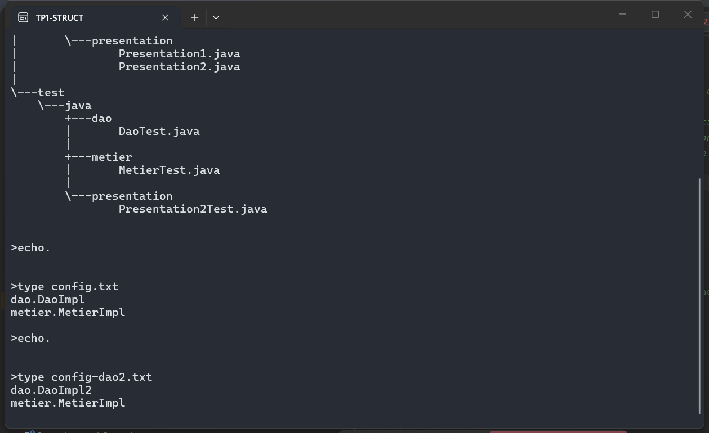
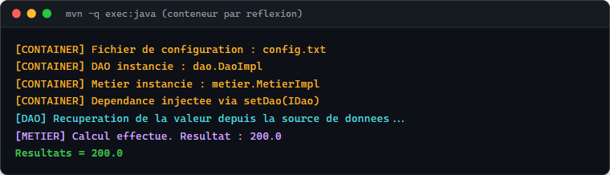
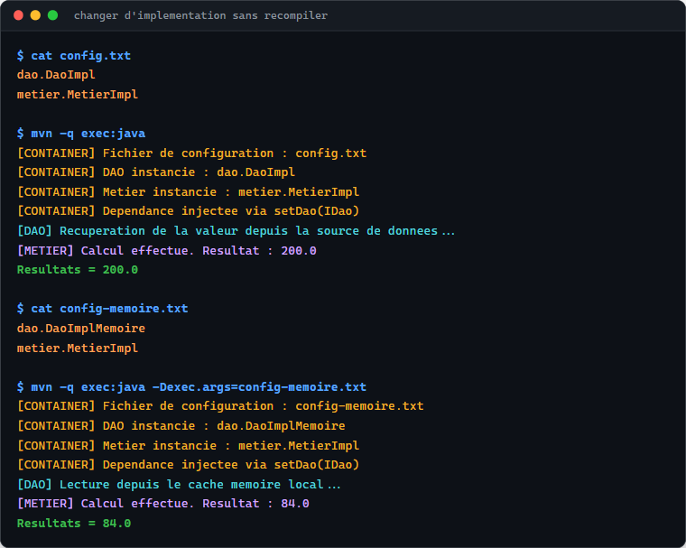
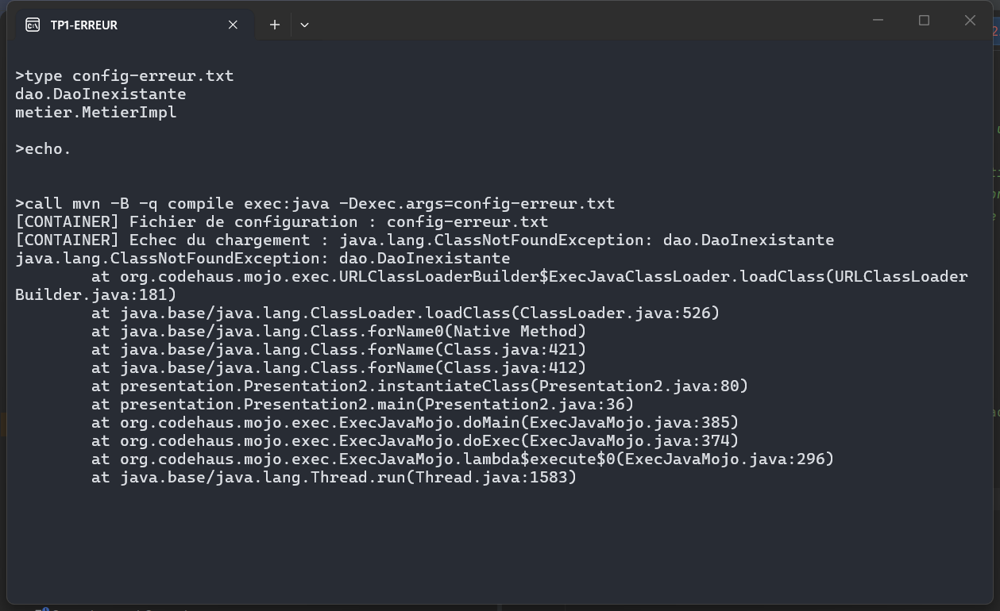
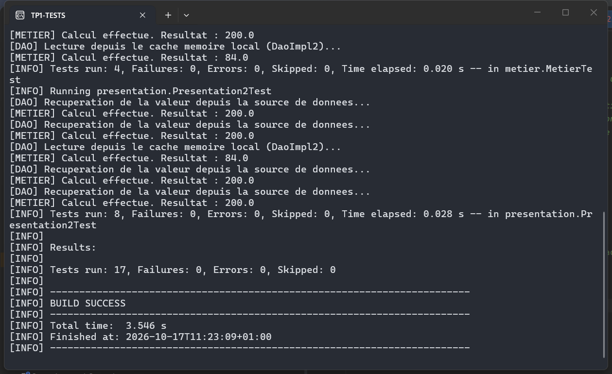

# TP 1 : Programmation dynamique par réflexion dans une architecture Microservices

## Structure du projet : arborescence des packages `dao`, `metier` et `presentation`

## Exécution : `mvn exec:java` charge les classes depuis `config.txt` → `Resultats = 200.0`

## Changer d'implémentation sans recompiler : `DaoImpl2` via `config-dao2.txt` → `Resultats = 84.0`

## Débogage : `ClassNotFoundException` sur un nom de classe invalide (`dao.DaoInexistante`)

## Tests unitaires : `Tests run: 17, Failures: 0` — `BUILD SUCCESS`
